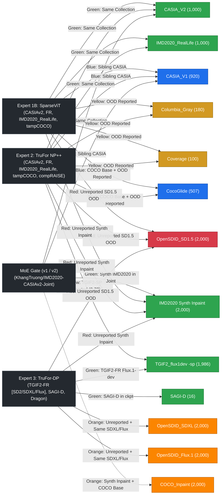

# Requirements & Architecture Specification: `ForensicMoE v2` (Multi-Scale Feature-Pyramid MoE) & Train–Test Intersection Audit

**Author**: Antigravity Assistant  
**Date**: November 19, 2026  
**Target Repository**: `khangtruong-ui/ai-detection-unet-gpu`  
**Predecessor**: [`docs/forensic_moe_prototype_v1_requirements.md`](forensic_moe_prototype_v1_requirements.md) (PR #30, `sid_unet/models/forensic_moe.py`)  
**Status**: Proposed Specification & PR Plan (No Implementation Code Yet)

---

## 1. Executive Summary

`ForensicMoE v1` (`415,725` trainable params in [`sid_unet/models/forensic_moe.py`](../sid_unet/models/forensic_moe.py) / [`configs/experiments/moe/forensic_moe_v1.yaml`](../configs/experiments/moe/forensic_moe_v1.yaml)) proved the frozen 3-expert pipeline (`SparseViT` + `TruFor NP++` + `TruFor-DiffusionPrint`) end-to-end, but its `0.42M` logit-only gate saturates too early during training.

This specification covers two goals:
1. **Complete Train–Test Intersection Audit (Color-Coded)** across the **exact training datasets** of all 3 frozen experts + the MoE gate versus all **15 test subsets** in [`configs/cross-eval/MVSS-v1-protocol.yaml`](../configs/cross-eval/MVSS-v1-protocol.yaml) (`KhangTruong/Tampered-Images-Combined-Dataset-Fake`, `cross_test`).
2. **`ForensicMoE v2` Architecture (~6.0M–8.5M trainable params, still < 4.5% of the 188M frozen ensemble):** Upgrades the gate from a `11`-channel logit convex combiner to a **Multi-Scale Cross-Expert Feature Router + Uncertainty-Gated Residual FPN Decoder** tapping the already-computed `512`-channel decoder and stage pyramids inside [`sid_unet/models/sparsevit.py`](../sid_unet/models/sparsevit.py) and [`sid_unet/models/trufor.py`](../sid_unet/models/trufor.py)—keeping all 3 experts **100% frozen** (zero forgetting).

---

## 2. Train–Test Intersection Audit (Color-Coded by Intersection Mode)

### 2.1 Exact Training Datasets per Component

1. **Expert 1B — `SparseViT`** ([`scu-zjz/SparseViT`](https://github.com/scu-zjz/SparseViT), `balanced_dataset.json`):
   - **Pretraining:** ImageNet-1k (`uniformer_base_ls_in1k.pth`)
   - **Training (`CAT-Net` protocol):** `CASIA v2.0`, `FantasticReality_v1`, `IMD2020_RealLife` (`IMD_20_1024`, 2,010 real-world web manipulations—**not** synthetic `KhangTruong/IMD2020`), `tampCOCO` (`sp_COCO`, `cm_COCO`, `bcm_COCO`, `bcmc_COCO`)
2. **Expert 2 — `TruFor (Noiseprint++)`** ([`grip-unina/TruFor`](https://github.com/grip-unina/TruFor), `trufor_ph3.yaml`, `arXiv:2212.10957`):
   - **Noiseprint++ pretraining:** Self-supervised camera/JPEG digital-history patches (authentic cameras)
   - **Training (`CAT-Net v2` protocol):** `CASIA v2.0`, `FantasticReality`, `IMD2020_RealLife` (2,010 fake + 414 real), `tampCOCO` (`COCO`), `compRAISE` (`RAISE`)
3. **Expert 3 — `TruFor-DiffusionPrint`** ([`mever-team/diffusionprint`](https://github.com/mever-team/diffusionprint), `trufor_diffusionprint.yaml`, `arXiv:2604.12443`):
   - **DiffusionPrint pretraining (`64×64` patches):** `giakoupg/diffusionprint_dataset` (SD2.1, SDXL, Flux + Dragon/COCO val2017/RAISE real & latent-reconstructed patches)
   - **Localization training (`detconfcmxdiffusionprint_tgif2sagid-bal-all`):** `TGIF2-FR` (`SD2-FR`, `SDXL-FR`, `FLUX.1 schnell/dev/fill-dev FR` on MS-COCO base images) + `SAGI-D` (`tgif2sagid`)
   - *(Contains **no** `CASIAv2`, **no** `IMD2020_RealLife`, **no** `tampCOCO`, **no** `OpenSDID`, **no** `KhangTruong/IMD2020`)*
4. **MoE Gate (`forensic_moe_v1` / `v2`):**
   - **Training:** `KhangTruong/IMD2020-CASIAv2-Joint` = `CASIA v2.0` (`casia`: 4,354) + `KhangTruong/IMD2020` (`imd2020`: 28,000 **synthetic inpainting** images)

---

### 2.2 Color Legend for Train–Test Intersection Modes

| Badge / Color | Mode Code | Exact Meaning |
|---|---|---|
|  | **Green (`DIRECT_TRAIN`)** | Same dataset collection / generator+pipeline in model's training set (split-disjoint images, but shared collection/style). |
|  | **Blue (`SIBLING_OR_GEN_OVERLAP`)** | Distinct dataset name, but shares direct dataset lineage (`CASIAv1`↔`CASIAv2`), generator family (`SDXL`/`Flux.1`), or **MS-COCO** base source images (`tampCOCO`↔`CocoGlide`). |
|  | **Yellow (`TRUE_OOD_REPORTED`)** | Disjoint image sources & manipulation pipeline; cross-eval metric **explicitly reported** in paper. |
|  | **Orange (`UNREPORTED_PARTIAL_OVERLAP`)** | **Unreported** in original paper, but shares generator family (`SDXL`/`Flux.1` in `OpenSDID`) or synthetic inpainting / COCO lineage (`COCO_Inpaint`). Transfer plausible but unverified. |
|  | **Red (`UNREPORTED_OOD_RISK`)** | **Unreported** in paper AND completely outside training domain; high failure risk. |
|  | **Gray (`OUT_OF_SCOPE`)** | Excluded from Prototype v1/v2 target scope (`HiFi_IFDL` face domain; `NIST16` deferred for GT polarity fix). |

---

### 2.3 Color-Coded Train $\to$ Test Intersection Graph



---

### 2.4 Full 15-Subset Train–Test Intersection Matrix (`MVSS-v1-protocol.yaml`)

| Test Subset (Count) | Base Source | Expert 1B (`SparseViT`) | Expert 2 (`TruFor NP++`) | Expert 3 (`TruFor-DP`) | MoE Gate (`IMD2020-CASIAv2-Joint`) | Effective Ensemble Coverage Mode |
|---|---|---|---|---|---|---|
| **`CASIA_V2` (1,000)** | Corel / CASIA |  |  |  |  | **Green** — Direct in-domain overlap (E1B, E2, Gate) |
| **`IMD2020_RealLife` (1,000)** | Internet real-life |  |  |  |  | **Green** — Direct in-domain overlap (E1B, E2) |
| **`CASIA_V1` (920)** | Corel / CASIA |  |  |  |  | **Blue** — Sibling CASIA lineage (E1B, E2, Gate) |
| **`Columbia_Gray` (180)** | DVMM Uncompressed |  |  |  |  | **Yellow** — Clean OOD reported (`0.86–0.96` F1) |
| **`Coverage` (100)** | Copy-Move pairs |  |  |  |  | **Yellow** — Clean OOD reported (`0.51–0.60` F1) |
| **`CocoGlide` (507)** | **MS-COCO** val |  |  |  |  | **Blue** — MS-COCO base overlap, unseen GLIDE |
| **`TGIF2_flux1dev` (1,986)** | **MS-COCO** |  | -d29922?style=flat-square) |  |  | **Green/Yellow** — E3 trained on `TGIF2-FR flux1dev`; E2 reported `0.73` on `-sp` |
| **`SAGI-D` (16)** | COCO / RAISE / OI |  |  |  |  | **Green** — Directly in `tgif2sagid` ckpt (E3) |
| **`OpenSDID_SDXL` (2,000)** | OpenSDI / COCO+ |  | -d29922?style=flat-square) |  |  | **Orange** — Unreported on OpenSDID, but E3 saw SDXL |
| **`OpenSDID_Flux.1` (2,000)** | OpenSDI / COCO+ |  | -d29922?style=flat-square) |  |  | **Orange** — Unreported on OpenSDID, but E3 saw Flux.1 |
| **`OpenSDID_SD1.5` (2,000)** | OpenSDI / COCO+ |  | -d29922?style=flat-square) |  |  | **Red** — SD1.5 unseen by all 3 experts (E3 only saw SD2.1+) |
| **`IMD2020` (2,000, synth)** | IMD2020 Inpaint |  |  |  |  | **Green (Gate only) / Red (All 3 Experts)** — Key reason v1 saturated! |
| **`COCO_Inpaint` (2,000)** | **MS-COCO** |  |  |  |  | **Orange/Red** — Same synthetic-inpainting gap as `IMD2020` |
| **`NIST16` (220)** | NIST Nimble 2016 |  |  |  |  | **Gray** — Deferred (invert-mask polarity bug in eval set) |
| **`HiFi_IFDL` (2,000)** | FFHQ / CelebA |  |  |  |  | **Gray** — Excluded facial domain |

> **Key Takeaway from the Intersection Matrix:**  
> On **Synthetic `IMD2020`** (`28,000` training samples in `KhangTruong/IMD2020-CASIAv2-Joint`), **ALL 3 frozen experts are Red (true OOD)** while **only the Gate sees it in training**. And on **MS-COCO-derived test sets** (`CocoGlide`, `TGIF2_flux1dev`, `COCO_Inpaint`, `SAGI-D`), all three experts share **MS-COCO source-image lineage** (`tampCOCO` / `TGIF2` / `Dragon`), meaning true non-COCO OOD generalization is primarily tested on `Columbia_Gray`, `Coverage`, `CASIA_V1`, `OpenSDID`, and `IMD2020`.

---

## 3. Diagnosis: Why `ForensicMoE v1` Saturated Too Early

Inspecting [`sid_unet/models/forensic_moe.py`](../sid_unet/models/forensic_moe.py) and [`configs/experiments/moe/forensic_moe_v1.yaml`](../configs/experiments/moe/forensic_moe_v1.yaml) reveals four structural bottlenecks:

1. **Convex-Hull Ceiling (`forensic_moe.py` line 285):**
   ```python
   moe_logits = (w_full * cal_logits).sum(dim=1, keepdim=True)
   ```
   Because $w_{\text{full}}(x, y) \in \Delta^2$ ($\sum_k w_k = 1, w_k \ge 0$), $z_{\text{MoE}}$ can never exceed $\max_k z'_k(x, y)$. Whenever all three frozen experts miss a region (such as synthetic `IMD2020` inpainting—**50% of every balanced training batch**), **no weighting $w_k$ can synthesize a positive prediction**.
2. **Throwing Away `1,536+` Rich Frozen Forensic Feature Channels:**
   - [`TruFor`](../sid_unet/models/trufor.py#L599) (`MLPDecoderHead`) already computes a **512-ch** fused representation at `H/4` (`128×128`) plus 4 CMX stage pyramids (`64, 128, 320, 512`), and `TruFor-DP` computes a **64-ch** `dncnn` generative fingerprint at full resolution.
   - [`SparseViT`](../sid_unet/models/sparsevit.py#L498) (`MultipleLFFHead`) already computes a **512-ch** LFF fused tensor at `H/16` (`32×32`) plus stage-2/3/4 pyramids (`128, 320, 512`).
   - `ForensicMoE v1` discards 100% of these tensors and forces a `415K` gate to operate on only **11 scalar/entropy channels**.
3. **Aggressive Image-Level Oracle KL (`oracle_loss_weight: 0.15`, `oracle_temperature: 0.15`):**
   Sharp temperature `0.15` pushes `alpha_img` toward a single per-image argmax winner, suppressing spatially complementary combinations (e.g., `SparseViT` crisp boundaries + `TruFor` interior reliability) and amplifying noisy winners on `IMD2020`.
4. **Under-Parameterized Spatial Head & Short Schedule (`10` epochs, `lr=5e-4`):**
   The `0.42M` head hits its capacity ceiling within ~1–2 epochs.

---

## 4. `ForensicMoE v2` Architecture (~6.0M–8.5M Trainable Params, Same 3 Frozen Experts)

### 4.1 Zero-Extra-FLOP Multi-Scale Feature Taps
Expose `return_features: bool = False` in [`SparseViT`](../sid_unet/models/sparsevit.py) and [`TruFor`](../sid_unet/models/trufor.py) (zero extra backbone compute—same `torch.no_grad()` pass):
- **From Expert 1B (`SparseViT`):**
  - `s1_h8`: stage-2 `[B, 128, 64, 64]` (`H/8`)
  - `s1_lff`: pre-`conv_last` LFF fused `[B, 512, 32, 32]` (`H/16`)
- **From Expert 2 (`TruFor NP++`) & Expert 3 (`TruFor-DP`):**
  - `s2_h4`, `s3_h4`: pre-`linear_pred` `MLPDecoderHead` fused `[B, 512, 128, 128]` (`H/4`)
  - `s2_h8`, `s3_h8`: CMX stage-2 `[B, 128, 64, 64]` (`H/8`)
  - `s2_h16`, `s3_h16`: CMX stage-3 `[B, 320, 32, 32]` (`H/16`)
  - `s2_h32`, `s3_h32`: CMX stage-4 `[B, 512, 16, 16]` (`H/32`)
  - `dp_h4`: `AvgPool2d(4)` of `TruFor-DP`'s `64-ch` DnCNN output `[B, 64, 128, 128]` (`H/4`)

### 4.2 Upgraded MoE Formulation: Mixture + Uncertainty-Gated Multi-Scale FPN Residual

$$z_{\text{MoE-v2}}(x, y) = \underbrace{\sum_{k=1}^{3} w_k(x, y) \cdot z'_k(x, y)}_{\text{Anchored Expert Mixture}} + \underbrace{g_{\text{unc}}(x, y) \odot \Delta z_{\text{FPN}}(F_1, F_2, F_3)}_{\text{Multi-Scale Residual Correction}}$$

1. **Multi-Scale Cross-Expert Attention Router (`~2.0M` params) $\to$ $w_k(x, y)$:**
   - Projects each expert's `H/16` (`32×32`) features to `96` channels (`1×1 Conv + GroupNorm + GELU`), concatenates with downsampled forensic maps (`cal_logits`, `conf_probs`, `entropy`), and applies a **Cross-Expert SE/Spatial Attention** block + upsampling to `H/4` (`128×128`) to predict smooth spatial routing logits $w_k(x, y) \in \Delta^2$.
   - Keeps per-expert affine logit calibration ($z'_k = \gamma_k z_k + \beta_k$).

2. **Top-Down Multi-Scale Residual FPN Decoder (`~4.5M–6.5M` params) $\to$ $\Delta z_{\text{FPN}}$:**
   - **Scale `H/32` (`16×16`):** Proj `[s2_h32, s3_h32]` (`1024 -> 192`)
   - **Scale `H/16` (`32×32`):** Proj `[s1_lff, s2_h16, s3_h16]` (`1152 -> 128`) + Upsample(`H/32`)
   - **Scale `H/8` (`64×64`):** Proj `[s1_h8, s2_h8, s3_h8]` (`384 -> 96`) + Upsample(`H/16`)
   - **Scale `H/4` (`128×128`):** Proj `[s2_h4, s3_h4, dp_h4, cal_logits, conf_probs, entropy]` (`1096 -> 64`) + Upsample(`H/8`)
   - **Full-Res Refinement (`128 -> 256 -> 512`):** Progressive `3×3` conv + bilinear upsample (`64 -> 32 -> 1`), with **zero-initialized final `1×1` conv** so $\Delta z_{\text{FPN}} \equiv 0$ at step 0.
   - *(Strictly no raw RGB semantics in $\Delta z_{\text{FPN}}$—operates solely on frozen forensic representations so it resists object-level overfitting.)*

3. **Uncertainty / Disagreement Gate $g_{\text{unc}}(x, y) \in (0, 1)$ (`~0.05M` params):**
   - Conditioned on `[mean_entropy(z'_1..3), std_k(z'_k), 1 - max(conf_2, conf_3)]` via a `3 -> 16 -> 1` conv (`bias` initialized at `-1.5`, i.e. $\approx 0.18$ initially).
   - **Behavior:** Where frozen experts already agree with high `conf_prob` (`Columbia_Gray`, `CASIA`, `TGIF2-SP`), $g_{\text{unc}}$ stays modest and preserves the zero-shot prior. Where all 3 experts are uncertain or disagree (`IMD2020` synthetic inpainting, `OpenSDID_SD1.5`), $g_{\text{unc}} \to 1$ and $\Delta z_{\text{FPN}}$ reconstructs the mask directly from the `1,536` frozen forensic channels.

### 4.3 Updated Training Recipe (`configs/experiments/moe/forensic_moe_v2.yaml`)
- **Trainable footprint:** `~6.5M–8.5M` params (< 4.5% of `188M` frozen ensemble; checkpoint ~25–34 MB); run online in `bf16` with frozen experts in `torch.no_grad()` + `.eval()`.
- **Routing Regularization:** Lower `oracle_loss_weight: 0.02` (or `0.0`), raise `oracle_temperature: 0.5`, retain `balance_loss_weight: 0.05`, and add mild L2 weight on $\Delta z_{\text{FPN}}$ (`1e-4`) to discourage unnecessary residual drift on clean classic images.
- **Mask Loss:** `0.4 * BCE + 0.4 * Dice + 0.2 * Focal(gamma=2.0)` (or edge-aware boundary loss) to sharpen fine inpainting contours.
- **Schedule & Augmentations:** `epochs: 20`, `learning_rate: 2e-4`, `weight_decay: 0.01`, `train_samples_per_epoch: 16000`, adding mild **random JPEG compression (`QF 65–100`)** alongside flips so the `6.5M` FPN head cannot overfit to `CASIAv2` vs `IMD2020` file-encoding quirks.

---

## 5. Expected Gains (v2 vs. v1) & Verification Plan

| Subset Group | v1 (`0.42M` Logit-Only Gate) | **v2 (`~6.5M–8.5M` Multi-Scale FPN + Uncertainty Gate)** |
|---|---|---|
| **Synthetic `IMD2020` & `COCO_Inpaint`** | Early plateau (trapped in convex hull of 3 Red/OOD experts) | **Substantial gain** — $\Delta z_{\text{FPN}}$ decodes directly from `64-ch` DP + `512-ch` `mit_b2`/`LFF` features |
| **`CASIA_V1/V2`, `Columbia_Gray`, `Coverage`** | Preserved classic baseline | **Maintained or sharper edges** via multi-scale `H/4`–`H/8` refinement & low $g_{\text{unc}}$ on confident regions |
| **`TGIF2_flux1dev`, `OpenSDID_SDXL/Flux.1`** | Limited by image-level scalar routing | **Better spatial selectivity** via `H/16` cross-expert attention + `64-ch` DiffusionPrint tap |

### Verification Checklist (GPU Target Machine)
- [ ] Add `return_features: bool = False` to `SparseViT` and `TruFor` without breaking existing `return_dict=True` contracts or checkpoints.
- [ ] Verify trainable parameter count (`~6.5M–8.5M`), zero frozen-expert parameter updates, and `step-0` equivalence when $\Delta z_{\text{FPN}}$ final conv is zero-initialized.
- [ ] Compare `forensic_moe_v2` vs `forensic_moe_v1` on both `KhangTruong/IMD2020-CASIAv2-Joint` (`val_iou` curve without early plateau) and `sid-cross-eval` across all 13 in-scope subsets of [`configs/cross-eval/MVSS-v1-protocol.yaml`](../configs/cross-eval/MVSS-v1-protocol.yaml), grouping scores by the color-coded **Green / Blue / Yellow / Orange / Red** intersection modes above.
