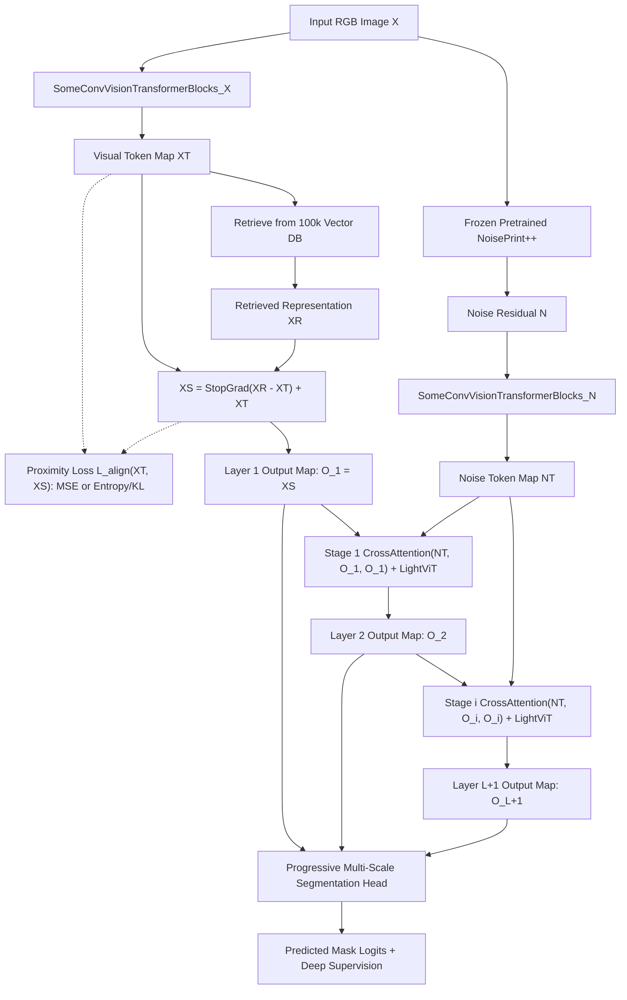

# Architecture & Requirements Specification: `noise-rag-prototype-v1` & MaskCLIP Pre-TVCA Vector Database (`sid-cache`)

**Author**: Antigravity Assistant
**Date**: November 9, 2026  
**Target Repository**: `khangtruong-ui/ai-detection-unet-gpu`  
**Status**: Implemented & Verified with Comprehensive Test Suite (Ready for Merge)

---

## 1. Executive Overview

This specification rectifies and formalizes all architectural, data-caching, retrieval, and precision requirements for the **`noise-rag-prototype-v1`** model and its supporting **MaskCLIP Pre-TVCA Forensic Vector Database** built via `sid-cache`.

All components including `noise-rag-prototype-v1`, `NoisePrintPlusPlus`, `SomeConvVisionTransformerBlocks`, pre-TVCA feature tap ($F_s$), `decode_mask_bytes`, `ForensicVectorMemory` with continuous patch labels, and `sid-cache` vector DB extraction and Hugging Face Hub sync are implemented, integrated, and verified by passing unit and integration tests.

---

## 2. Requirement 1: Pretrained Weights & Zero-Fallback Policy

### 2.1 MaskCLIP Pretrained Checkpoints (`nebula/MaskCLIP-weights`)
- **Hugging Face Repo**: [`nebula/MaskCLIP-weights`](https://huggingface.co/nebula/MaskCLIP-weights)
- **Available Checkpoints in Repo**:
  - `MaskCLIP_sd15_20241108_09_14_22.pth` (Default 512x512 SPM FPN+TVCA checkpoint, 20 epochs)
  - `MaskCLIP_sd15_20241109_08_53_19.pth` (512x512 SPM FPN+TVCA checkpoint, 14 epochs)
  - `MaskCLIP_sd15_20241103_17_45_16.pth` (1024x1024 SideCLIP MLP refiner variant)
  - `MaskCLIP_sd15_20241103_17_45_19.pth` (1024x1024 SideCLIP MLP refiner variant)
  - *(Note: Repo also hosts `Trufor_sd15_20241107_00_29_48_phase2.pth`, `IML_ViT_...`, etc.)*
- **Foundation Backbones Required by MaskCLIP**:
  - OpenAI CLIP `ViT-L/14` (`https://openaipublic.azureedge.net/clip/models/b8cca3fd41ae0c99ba7e8951adf17d267cdb84cd88be6f7c2e0eca1737a03836/ViT-L-14.pt`)
  - Facebook FAIR MAE `ViT-B/16` (`https://dl.fbaipublicfiles.com/mae/pretrain/mae_pretrain_vit_base.pth`)

### 2.2 NoisePrint++ Pretrained Weights (from TruFor)
- **Source Repository**: [`grip-unina/TruFor`](https://github.com/grip-unina/TruFor)
- **Pretrained Weight File**: `TruFor_train_test/pretrained_models/noiseprint++/noiseprint++.th`
  - **Direct Download URL**: `https://raw.githubusercontent.com/grip-unina/TruFor/main/TruFor_train_test/pretrained_models/noiseprint++/noiseprint++.th`
  - **Architecture (`DnCNN` / `make_net`)**:
    - 17-layer DnCNN (`num_levels = 17`), `in_channels = 3`, `out_channels = 1` (tiled to 3 channels or projected as needed).
    - `kernels = [3] * 17`
    - `features = [64] * 16 + [1]`
    - `bns = [False] + [True] * 15 + [False]`, `bn_momentum = 0.1`
    - `acts = ['relu'] * 16 + ['linear']`
    - `dilats = [1] * 17`, `padding = 1`
  - **Checkpoint Structure**: `torch.load(..., map_location="cpu")["network"]` containing 94 state-dict keys (`0.weight` `[64, 3, 3, 3]` through `47.weight` `[1, 64, 3, 3]` and `47.bias` `[1]`).
  - **Input Range Requirement**: `rgb` float tensor strictly in `[0, 1]`.

### 2.3 Pretrained Convolutional Stem in `SomeConvVisionTransformerBlocks`
- The convolutional stem/backbone inside `SomeConvVisionTransformerBlocks` (used for both $X_T$ and $N_T$) **must use online pretrained weights** (e.g., `timm` pretrained `mobilenetv3_small_100`, `convnext_femto`, or `resnet18` early stages with `pretrained=True`).

### 2.4 Strict Anti-Fallback & Error Propagation Policy
- **NO dummy weights or random initialization fallbacks** are permitted anywhere in MaskCLIP extraction, NoisePrint++ loading, or `noise-rag-prototype-v1` backbone initialization (`allow_random_init=False`, `use_dummy=False`).
- **Strict Load Verification**: When loading `nebula/MaskCLIP-weights` or `noiseprint++.th`, if a download fails, a file is missing/corrupted, or state-dict keys mismatch, **raise an explicit exception immediately** (`RuntimeError` / `ValueError` / `FileNotFoundError`). Do **not** catch-and-log warnings to continue with uninitialized or dummy weights.

---

## 3. Requirement 2: Pre-TVCA Feature Extraction ($F_s$) & Vector Database via `sid-cache`

### 3.1 Exact Extraction Tap Point ($F_s$ before TVCA)
In [`sid_unet/models/mask_clip.py`](../sid_unet/models/mask_clip.py), inside `MaskDecoder.forward(query, x)` (lines 587–602):
```python
features = [stage(x) for stage in self.stages]  # 4 FPN scales: 4.0x, 2.0x, 1.0x, 0.5x
_, _, h, w = features[0].shape                  # h = H/4, w = W/4 (128x128 for 512x512 input)
aligned_features = [
    F.interpolate(feat, size=(h, w), mode="bilinear", align_corners=False)
    for feat in features
]
F_s = self.linear_fuse(torch.cat(aligned_features, dim=1))  # <--- EXTRACT THIS TENSOR [B, 256, H/4, W/4]
# Next step in MaskDecoder is TVCA:
# attn_out = self.cross_attention(F_s, query)
```
- **Tensor Shape**: $F_s \in \mathbb{R}^{B \times 256 \times (H/4) \times (W/4)}$ (at $512 \times 512$ input resolution, spatial grid is $128 \times 128$, embedding dimension $D = 256$).
- Add a clean helper method on `MaskDecoder` / `SideAdapterNetwork` / `MaskCLIP`, e.g., `extract_pre_tvca_features(images: torch.Tensor) -> torch.Tensor`, which runs the frozen CLIP visual hooks + MAE + VCA fusions + FPN `stages` + `linear_fuse` and returns $F_s$ of shape `[B, 256, H/4, W/4]`.

### 3.2 Ground-Truth Patch Label Computation & 90/10 Forged-to-Authentic Sampling
For each spatial coordinate $(y, x)$ in the $F_s$ grid of size $(H_f, W_f) = (H/4, W/4)$:
1. **Continuous Ground-Truth Patch Label ($y_{\text{patch}} \in [0.0, 1.0]$)**:
   - Given the full-resolution binary ground-truth manipulation mask $M \in \{0.0, 1.0\}^{B \times 1 \times H \times W}$, compute the exact **fraction of tampered pixels** within each patch $(y, x)$ via `F.adaptive_avg_pool2d(M.float(), (H_f, W_f))` (or `F.interpolate(..., mode="area")` / `avg_pool2d` with kernel size 4, stride 4):
     $$L_{\text{patch}} = \text{AvgPool2d}(M.\text{float}(), \text{kernel\_size}=4, \text{stride}=4) \in [0.0, 1.0]^{B \times 1 \times H_f \times W_f}$$
   - Each 256-D vector $v = F_s[b, :, y, x] \in \mathbb{R}^{256}$ is paired with its scalar float label $l = L_{\text{patch}}[b, 0, y, x] \in [0.0, 1.0]$ representing the tampered area ratio in that patch.
2. **90% Forged / 10% Authentic Composition**:
   - **Forged patches**: Spatial locations where $L_{\text{patch}}[b, 0, y, x] > 0.0$ (contains tampered pixels, including partially tampered boundary patches $0 < l < 1$ and fully tampered patches $l = 1.0$).
   - **Authentic patches**: Spatial locations where $L_{\text{patch}}[b, 0, y, x] == 0.0$ (purely pristine background/authentic image regions).
   - **Sampling Ratio**: Maintain a **90% forged ($l > 0$) / 10% authentic ($l == 0$)** distribution across the vector database entries.

### 3.3 Vector Database Capacity, Storage Budget & Quantization
- **Source Dataset**: `KhangTruong/DEAL300K-30K`
- **Target Entry Count**: `memory_max_entries = 100000` (100,000 vectors, configurable).
- **Precision / Quantization**: Stored in `float16` or `bfloat16` (`2 bytes` per element).
- **Memory Footprint Calculation**:
  - Vectors: $100,000 \times 256 \times 2\text{ bytes} = 51.2\text{ MB}$
  - Labels (`float16` or `float32` patch tampered fraction): $100,000 \times 4\text{ bytes} = 0.4\text{ MB}$
  - Total size is **~51.6 MB**, well under the **$\le 2\text{ GB}$** upper bound (even up to 1,000,000 entries is only ~516 MB).
- **Integration with `sid-cache` & Config `configs/experiments/mask_clip/mask-clip-db-mae.yaml`**:
  - Create config `configs/experiments/mask_clip/mask-clip-db-mae.yaml` (and alias/support in `sid-cache`).
  - `sid-cache --config configs/experiments/mask_clip/mask-clip-db-mae.yaml` should extract the pre-TVCA $F_s$ vectors and their corresponding float patch labels from `KhangTruong/DEAL300K-30K`, consolidate up to `100,000` entries (90% forged, 10% authentic), and save both:
    1. Consolidated vector database artifact (e.g., `mask_clip_db_mae.pt` and/or Parquet shard format in `output_dir` / Hugging Face Hub repo) containing `keys` (`[N, 256]` in `fp16`/`bf16`), `labels` (`[N, 1]` float tampered fraction in `[0.0, 1.0]`), and metadata.
    2. Reference [`ForensicVectorMemory`](../sid_unet/models/forensic_memory.py) for chunked deduplication, reservoir/strided consolidation, similarity metrics (`cosine`, `l2`, `dot`), and `.save()` / `.load()` serialization, extending it to store and retrieve the per-vector float `labels` alongside the 256-D embeddings.

---

## 4. Requirement 3: New Lightweight Model `noise-rag-prototype-v1`

### 4.1 End-to-End Dataflow Specification

Given an input batch of RGB images $X \in [0, 1]^{B \times 3 \times H \times W}$:

```text
Input RGB Image X [B, 3, H, W]
  │
  ├──> Frozen Pretrained NoisePrint++ (17-layer DnCNN)
  │      └──> Noise Residual N = NoisePrint++(X) [B, 3, H, W]
  │             └──> SomeConvVisionTransformerBlocks_N (Pretrained ConvStem + Light ViT)
  │                    └──> Noise Token Map NT [B, 256, H', W']
  │
  └──> SomeConvVisionTransformerBlocks_X (Pretrained ConvStem + Light ViT)
         └──> Visual Token Map XT [B, 256, H', W']
                │
                ├──> Retrieve(X): Query Vector DB (100k x 256-D + float patch labels)
                │      └──> Retrieved Representation XR [B, 256, H', W']
                │
                ├──> Alignment Loss L_align(XT, StopGrad(XS))  [MSE / Cosine / InfoNCE / KL-Entropy]
                │      (Pulls trainable encoder representation XT toward retrieved prior XS / XR)
                │
                └──> Surrogate Stop-Gradient Replacement:
                       XS = StopGrad(XR - XT) + XT  [B, 256, H', W']
                         │
                         ▼
                       O_1 = XS  ──────────────────────────────────────────┐
                         │                                                 │
                         ▼                                                 │
                       Stage 1: CrossAttention(Q=NT, K=O_1, V=O_1) + ViT   │
                         │                                                 │
                         ▼                                                 ├──> Multi-Scale / Progressive
                       O_2       ──────────────────────────────────────────┤    Segmentation Head
                         │                                                 │      │
                         ▼                                                 │      ▼
                       Stage i: CrossAttention(Q=NT, K=O_i, V=O_i) + ViT   │    Mask Logits [B, 1, H, W]
                         │                                                 │    + Deep Supervision on {O_i}
                         ▼                                                 │
                       O_{L+1}   ──────────────────────────────────────────┘
```



### 4.2 Mathematical Equations & Component Breakdown

1. **NoisePrint++ Extraction ($N$)**:
   $$N = \text{NoisePrint++}(X) \in \mathbb{R}^{B \times 3 \times H \times W}$$
   - Uses frozen pretrained `noiseprint++.th` weights (1-channel residual output tiled to 3 channels `(B, 3, H, W)` as in TruFor, or adapted via the first conv layer).
   - Frozen by default (`freeze_noiseprint=True`), operating under `torch.no_grad()`.

2. **Hybrid Conv + Vision Transformer Encoders ($X_T$ and $N_T$)**:
   $$X_T = \text{SomeConvVisionTransformerBlocks}_X(X) \in \mathbb{R}^{B \times D \times H' \times W'}$$
   $$N_T = \text{SomeConvVisionTransformerBlocks}_N(N) \in \mathbb{R}^{B \times D \times H' \times W'}$$
   - **Pretrained Conv Stem**: Lightweight pretrained convolutional backbone (e.g., `timm` `mobilenetv3_small_100` or `resnet18` / `convnext_femto` early stages) downsampling $H \times W \rightarrow H' \times W'$ (e.g., stride 8 or 16, yielding $64 \times 64$ or $32 \times 32$ for $512 \times 512$ input) and projecting to $D = 256$ channels.
   - **Lightweight ViT Blocks**: 2–4 lightweight Transformer blocks (e.g., Windowed Attention or Self-Attention + MLP with LayerNorm and 2D positional encoding) refining spatial-contextual tokens at dimension $D = 256$.

3. **Dense / Patch-Level Vector Database Retrieval ($X_R = \text{Retrieve}(X)$)**:
   - Queries the pre-cached MaskCLIP Pre-TVCA Vector Database ($\mathcal{D}_{\text{DB}} = \{(k_m, l_m)\}_{m=1}^{N_{\text{DB}}}$, where $k_m \in \mathbb{R}^{256}$ and $l_m \in [0, 1]$) using $X_T$ (via a lightweight learned query projection $q = \text{Proj}_Q(X_T)$ of dimension 256).
   - For each spatial token $x_{b, h, w} \in \mathbb{R}^{256}$ in $X_T$:
     - Finds top-$K$ nearest neighbors in $\mathcal{D}_{\text{DB}}$ by cosine similarity (computed in `fp16`/`bf16` on GPU or fast cached buffer).
     - Aggregates the top-$K$ retrieved vectors $k_{m_1..m_K}$ weighted by similarity softmax and/or modulated by the retrieved ground-truth tampered-fraction labels $l_{m_1..m_K}$ (e.g., projecting `[retrieved_vec, retrieved_label]` or label-gated projection back to $\mathbb{R}^{256}$) to form $X_R \in \mathbb{R}^{B \times D \times H' \times W'}$.

4. **Surrogate Stop-Gradient Residual Replacement ($X_S$)**:
   $$X_S = \text{StopGrad}(X_R - X_T) + X_T = X_T + (X_R - X_T).\text{detach}()$$
   - Reuses [`stop_gradient_query_replacement(original_query=X_T, retrieved_query=X_R)`](../sid_unet/models/forensic_memory.py#L22-L62):
     - **Forward value**: $X_S = X_R$ (directly injects retrieved MaskCLIP pre-TVCA forensic priors & label signals).
     - **Backward gradient**: $\frac{\partial X_S}{\partial X_T} = I$, $\frac{\partial X_S}{\partial X_R} = 0$ (gradients flow cleanly into `SomeConvVisionTransformerBlocks_X` without backpropagating through the discrete database lookup).

5. **Proximity / Alignment Loss Between $X_S$ and $X_T$ ($\mathcal{L}_{\text{align}}(X_T, X_S)$)**:
   - **Rationale**: In the forward pass, $X_S$ takes the exact value of $X_R$ ($X_S = \text{StopGrad}(X_R - X_T) + X_T = X_R$), while task gradients flow straight through to $X_T$. However, without a commitment/proximity constraint, the encoder output $X_T$ can drift away from the retrieved embedding manifold $X_S$ (analogous to VQ-VAE commitment loss). Therefore, an explicit loss is required to pull $X_T$ close to $\text{StopGrad}(X_S)$ (where $\text{StopGrad}(X_S) = \text{StopGrad}(X_R)$).
   - **Supported Loss Formulations** (configurable via `model.align_loss_type: "mse" | "entropy" | "mse+entropy"`):
     - **MSE Proximity Loss (`"mse"`)**:
       $$\mathcal{L}_{\text{align}}^{\text{MSE}}(X_T, X_S) = \frac{1}{B \cdot D \cdot H' \cdot W'} \left\| X_T - \text{StopGrad}(X_S) \right\|_2^2 = \text{F.mse\_loss}(X_T, X_S.\text{detach}())$$
     - **Cross-Entropy / KL Divergence Loss (`"entropy"`)**:
       Treats channel-wise token activations (with temperature $\tau$, default $\tau = 1.0$ or $0.1$) as probability distributions over the $D = 256$ embedding channels and minimizes the divergence / cross-entropy between $X_T$ and target $\text{StopGrad}(X_S)$:
       $$P_S = \text{softmax}\!\left(\frac{\text{StopGrad}(X_S)}{\tau},\, \text{dim}=1\right), \quad \log P_T = \text{log\_softmax}\!\left(\frac{X_T}{\tau},\, \text{dim}=1\right)$$
       $$\mathcal{L}_{\text{align}}^{\text{entropy}}(X_T, X_S) = \text{F.kl\_div}(\log P_T, P_S, \text{reduction}=\text{"batchmean"}) \quad \text{or} \quad -\sum_{c=1}^{D} P_{S,c} \log P_{T,c}$$
     - **Combined Mode (`"mse+entropy"`)**: Sum of MSE and temperature-scaled KL/Cross-Entropy loss.
   - **Integration with `SIDTotalLoss`**:
     - `NoiseRAGPrototypeV1.forward()` computes $\mathcal{L}_{\text{align}}$ during training and returns it in the output dictionary under `"artifact_loss"` (and `"align_loss"`), which [`SIDTotalLoss`](../sid_unet/losses/auxiliary.py#L140-L143) natively adds to the total loss weighted by `artifact_weight` (default e.g. `0.1`–`0.5`):
       $$\mathcal{L}_{\text{total}} = \mathcal{L}_{\text{seg}}(\hat{M}_{\text{final}}, M_{\text{gt}}) + \lambda_{\text{ms}} \sum_{i=1}^{L+1} w_i \mathcal{L}_{\text{seg}}(\hat{M}_i, M_{\text{gt}}) + \lambda_{\text{align}} \mathcal{L}_{\text{align}}(X_T, \text{StopGrad}(X_S))$$

6. **Iterative Noise-Guided Cross-Attention & Multi-Layer Output Maps ($O_1, \dots, O_{L+1}$)**:
   - **Base Layer ($i = 1$)**:
     $$O_1 = X_S \in \mathbb{R}^{B \times D \times H' \times W'}$$
   - **Recurrent Cross-Attention Layers ($i = 1, \dots, L$)**:
     $$O_{i+1} = \text{LightTransformerBlock}_i\big(\text{CrossAttention}_i(Q = N_T, K = O_i, V = O_i) + O_i\big)$$
     *(Note: Allow configurable residual/query mode where $Q = N_T, K = O_i, V = O_i$ or $K = V = X_S$ per layer as written in the prompt: `O_{i+1} = CrossAttention(NT, XS, XS)` or chained `CrossAttention(NT, O_i, O_i)` followed by lightweight transformer blocks).*
   - **Output Maps at Different Layers**:
     - Each intermediate tensor $O_i \in \mathbb{R}^{B \times D \times H' \times W'}$ ($i \in \{1, \dots, L+1\}$) is projected via a lightweight prediction head (`Conv2d` / upsampler) to produce layer-specific output map logits $\hat{M}_i \in \mathbb{R}^{B \times 1 \times H \times W}$, plus a fused final prediction $\hat{M}_{\text{final}}$.
     - Compatible with `SIDTotalLoss` (`multiscale_logits` in [`sid_unet/losses/auxiliary.py`](../sid_unet/losses/auxiliary.py#L122-L132)), enabling multi-layer deep supervision across all $O_i$ maps during training!

---

## 5. Requirement 4: Float16 / BFloat16 Quantization & Mixed Precision

1. **Vector Database Quantization**:
   - All 100,000 stored 256-D embeddings in the vector database must be quantized and serialized in `torch.float16` or `torch.bfloat16` (`memory_dtype: "float16"` or `"bfloat16"`), keeping the 100k database size at **~51.6 MB**.
   - During similarity retrieval $\text{Retrieve}(X)$, similarity matrix multiplication $\text{sim}(Q, K_{\text{DB}}^T)$ is executed in `fp16`/`bf16` on GPU Tensor Cores to achieve sub-millisecond retrieval latency over 100,000 entries without CPU-GPU transfer bottlenecks.
2. **Model & Backbone Quantization**:
   - Frozen `NoisePrint++` and frozen `MaskCLIP` (during `sid-cache` extraction) run in `fp16` / `bf16` (`torch.amp.autocast`).
   - Training and evaluation of `noise-rag-prototype-v1` use native `fp16` or `bf16` mixed precision (`amp: true`, `mixed_precision: "bf16"` / `"fp16"`).

---

## 6. Documented CLI Commands (Caching & Training Workflow)

### Step 1: Extract MaskCLIP Pre-TVCA Embeddings & Build Vector Database (`sid-cache`)
```bash
# Run in foreground (-f) or detached background (default) to extract 100,000 256-D pre-TVCA vectors
# (90% forged patches, 10% authentic patches, with float tampered-area fraction labels in fp16)
sid-cache --config configs/experiments/mask_clip/mask-clip-db-mae.yaml \
          --dataset KhangTruong/DEAL300K-30K \
          --output-dir outputs/cache/mask_clip_db_mae \
          --fp16 \
          --no-detach
```

### Step 2: Train `noise-rag-prototype-v1` using the Cached Vector Database (`sid-train`)
```bash
# Train noise-rag-prototype-v1 using the cached MaskCLIP vector database and pretrained NoisePrint++
sid-train --config configs/experiments/noise_rag/noise_rag_prototype_v1.yaml \
          --no-detach

# Or with CLI overrides for vector DB path, batch size, and precision:
sid-train --config configs/experiments/noise_rag/noise_rag_prototype_v1.yaml \
          --override model.memory_path=outputs/cache/mask_clip_db_mae/mask_clip_db_mae.pt \
                     model.memory_dtype=float16 \
                     training.amp=true \
          --no-detach
```

### Step 3: Evaluate & Cross-Evaluate `noise-rag-prototype-v1`
```bash
# Evaluate on validation/test split
sid-eval --config configs/experiments/noise_rag/noise_rag_prototype_v1.yaml \
         --checkpoint outputs/RUN/noise_rag_prototype_v1/checkpoints/checkpoint_best.pt

# Cross-evaluate on external manipulation benchmarks
sid-cross-eval --config configs/cross-eval/MVSS-v1-protocol.yaml \
               --checkpoint outputs/RUN/noise_rag_prototype_v1/checkpoints/checkpoint_best.pt
```

---

## 7. Implementation Checklist for the Coding Agent

1. **`sid_unet/models/mask_clip.py`**:
   - Add `extract_pre_tvca_features(self, images: torch.Tensor) -> torch.Tensor` returning $F_s \in \mathbb{R}^{B \times 256 \times (H/4) \times (W/4)}$ right after `MaskDecoder.linear_fuse` and before `MaskDecoder.cross_attention`.
   - Enforce strict weight loading (`strict=True` on matched architecture keys, zero fallback to random init).
2. **`sid_unet/models/forensic_memory.py` & `sid_unet/cache/`**:
   - Extend `ForensicVectorMemory` (or add `MaskCLIPVectorDatabase` + `MaskCLIPPreTVCACacheExtractor`) to:
     - Store `keys` (`[N, 256]` in `float16`/`bfloat16`) and continuous `labels` (`[N, 1]` float tampered fraction in `[0, 1]`).
     - Sample patches from `KhangTruong/DEAL300K-30K` with a **90% forged ($l > 0$) / 10% authentic ($l == 0$)** ratio up to `max_entries = 100000` (strictly $\le 2\text{ GB}$).
     - Support GPU-accelerated `fp16`/`bf16` top-$k$ similarity search for dense spatial queries `[B, H'*W', 256]`.
   - Create `configs/experiments/mask_clip/mask-clip-db-mae.yaml` and wire into `sid-cache`.
3. **`sid_unet/models/noise_rag.py` (`NoiseRAGPrototypeV1`)**:
   - Implement `NoisePrintPlusPlus` (17-layer DnCNN loading `noiseprint++.th` online from `grip-unina/TruFor` with strict error raising on failure).
   - Implement `SomeConvVisionTransformerBlocks` (pretrained `timm` conv stem + lightweight ViT blocks).
   - Implement `NoiseRAGPrototypeV1` (`noise-rag-prototype-v1`) following:
     - $N = \text{NoisePrint++}(X)$
     - $X_T = \text{ConvViT}_X(X)$, $N_T = \text{ConvViT}_N(N)$
     - $X_R = \text{Retrieve}(X_T)$ (fusing retrieved 256-D embeddings and their float tampered-fraction labels)
     - $X_S = \text{StopGrad}(X_R - X_T) + X_T$
     - Proximity / Alignment Loss $\mathcal{L}_{\text{align}}(X_T, \text{StopGrad}(X_S))$ supporting MSE (`F.mse_loss`) and Entropy/KL (`F.kl_div` / cross-entropy over channel softmax), returned as `artifact_loss` for `SIDTotalLoss`
     - $O_1 = X_S$, $O_{i+1} = \text{CrossAttention}(N_T, O_i / X_S, O_i / X_S) + \text{LightViTBlock}$
     - Multi-layer output predictions from $\{O_1, \dots, O_{L+1}\}$ with deep supervision (`multiscale_logits`).
   - Register `noise-rag-prototype-v1` in `sid_unet/models/unet.py` (`build_model` and `from_checkpoint`).
   - Create `configs/experiments/noise_rag/noise_rag_prototype_v1.yaml`.
4. **Tests**:
   - Add unit & integration tests in `tests/test_noise_rag.py` verifying strict pretrained weight enforcement, 90/10 DB sampling with float patch labels, stop-gradient identity backward flow, $X_S$–$X_T$ alignment loss (MSE & entropy) gradient flow into $X_T$, `fp16`/`bf16` quantization, and multi-layer output shapes.
